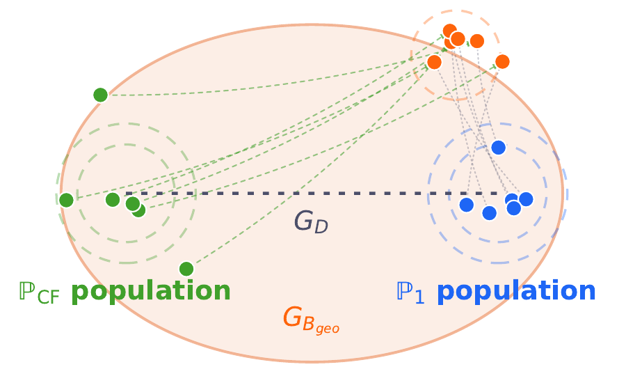
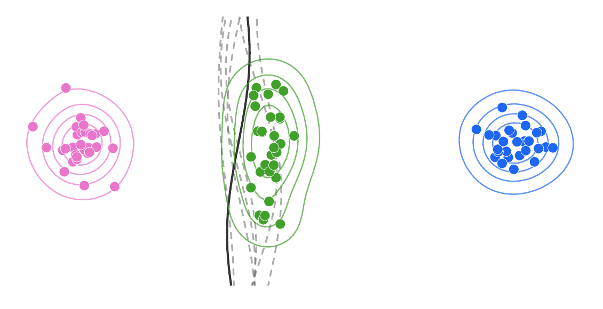

# GRACE: Population-Level Adversarially Robust Counterfactual Explanations

**Anonymous submission · Under review at ICLR 2027**

[Reproduction guide](docs/reproducibility.md) · [Wachter example](deliverables/grace-wachter/README.md)

GRACE (**Geometrically Restricted Adversarially robust Counterfactual Explanations**) is a post-hoc framework for refining a population of counterfactual explanations (CFs). It builds on existing generators, including Wachter and DiCE, and optimizes their future validity under a shared model-update mechanism while constraining how far the CF population moves.

<p align="center">
  
</p>

*Figure 2 of the paper: the base CF population and favorable training population define a bounded transport-detour region for refinement.*

## Why population-level robustness?

A CF valid under today's classifier may become invalid after retraining. The same updated classifier evaluates the entire issued population. GRACE models that shared risk rather than assigning a separate worst-case model to each individual CF.

<p align="center">
  
</p>

*Figure 1 of the paper: a shared decision-boundary shift can invalidate many previously valid CFs. Both illustrations above are direct crops of the supplied paper, not recreated diagrams.*

## Method

Given base CFs, GRACE constructs an equal-mass population $P_{\mathrm{CF}}$ and a favorable-data anchor $P_1$. A perturbation of the **training distribution** induces a future classifier through the prescribed update operator. The population robust risk is

$$
\Phi_r(Q)=\sup_{P:\,W_{\mathrm{data}}(P,\widehat P_{\mathrm{tr}})\le r}
\mathbb{E}_{z\sim Q}\bigl[\ell_{\mathrm{Update}(f_0,P)}(z)\bigr].
$$

The supremum is outside the population expectation: all CFs share the same future model. The numerical method differentiates through the model update and minimizes the first-order surrogate

$$
\widetilde\Phi_r(Q)=F_Q+r\|s_Q\|_*,
\qquad
W_2(P_{\mathrm{CF}},Q)+W_2(Q,P_1)
\le \beta_{\mathrm{geo}}W_2(P_{\mathrm{CF}},P_1).
$$

Here $F_Q$ is the nominal population loss **after the unperturbed prescribed update**, and $s_Q$ is its update-aware sensitivity to training-distribution perturbations. The implementation retains the empirical dual-norm scaling. The two Wasserstein geometries concern different objects: training-distribution uncertainty and CF-population displacement.

The procedure is:

1. Generate Base CFs and construct the favorable-data anchor.
2. Refine their support points jointly using the smooth loss, update-aware sensitivity, and two-anchor constraint.
3. Deploy one CF per factual using minimum-cost one-to-one matching from Base to the refined population.
4. Evaluate the fixed CFs on shared held-out future models.

This is a local surrogate optimization, not a certificate of validity for every individual under arbitrary future retraining. See Section 3 and Algorithm 1 of the [paper](iclr_robust_ce-88.pdf) for assumptions and details.

## Installation and a first experiment

Use Python 3.11 for the recorded environment. A self-contained **Wachter + GRACE tabular example** is available without the image assets or baseline solver dependencies:

```bash
python -m venv .venv
source .venv/bin/activate
python -m pip install -r deliverables/grace-wachter/requirements.txt
python deliverables/grace-wachter/run.py --help
```

From the repository root, run Diabetes with a new output directory:

```bash
OMP_NUM_THREADS=1 OPENBLAS_NUM_THREADS=1 MKL_NUM_THREADS=1 \
python deliverables/grace-wachter/run.py \
  --dataset diabetes --model mlp --device cpu \
  --data-home ./data-cache --output ./outputs/diabetes_mlp_run1
```

Use `--device cuda:0` with a compatible CUDA/PyTorch environment. CPU execution is supported by this standalone runner; its default calibration grid is a full experiment, not a fast smoke test. Existing output directories are refused.

The example contains Wachter and GRACE only. For the full source tree, optional baselines, image experiments, and verification commands, see the [reproduction guide](docs/reproducibility.md). Installation commands are provided for a fresh environment; a fresh dependency installation was not executed during this documentation update.

## Data preparation

The standalone tabular runner downloads through OpenML on first use and fits preprocessing on the training split only.

| Dataset / representation | Input | Preparation |
|---|---|---|
| Diabetes | OpenML data ID 37 | Favorable label: `tested_negative` |
| German Credit | OpenML data ID 31 | Favorable label: `good`; categorical features encoded from training data |
| HELOC | OpenML `heloc`, version 1 | Continuous representation; missing codes handled by the loader |
| FICO | Local `heloc_dataset_v1.csv` | Mixed representation; `MaxDelq2PublicRecLast12M` and `MaxDelqEver` are categorical |

For mixed FICO, provide the separately obtained CSV:

```bash
python deliverables/grace-wachter/run.py \
  --dataset fico --model logistic --device cpu \
  --csv /path/to/heloc_dataset_v1.csv \
  --data-home ./data-cache --output ./outputs/fico_logistic_run1
```

The [FICO preparation record](experiments/configs/fico_mixed_task100.json) identifies the source and preprocessing. The continuous HELOC and mixed FICO loaders use two representations of the same underlying corpus. Dataset redistribution is not included.

Image workflows use frozen generators, classifiers, Base latent codes, and training/reference populations. These assets must be staged separately; see [required assets and experiment entry points](docs/reproducibility.md#experiment-entry-points).

## Experiments and evaluation

The paper evaluates tabular CFs on HELOC, Diabetes, German Credit, and FICO; image CFs on MNIST, Galaxy10 DECaLS, and FFHQ; and a discrete text adaptation on ParaDetox in the appendix. Wachter and DiCE are the tabular Base generators; the image experiments build on LeapFactual.

| Metric | Meaning |
|---|---|
| **Future Validity (FV)** | Fraction of fixed CFs receiving the desired prediction after model updates, averaged over the evaluation scenarios |
| **Current Validity (CV)** | Fraction of CFs receiving the desired prediction from the deployed classifier before those updates |
| **Proximity** | Mean factual-to-assigned-CF distance, using the experiment's representation and metric |
| **Classifier accuracy** | Predictive accuracy on labeled examples; distinct from both FV and CV |

The paper's tabular protocol uses 45 future-model scenarios per split: three shift families, three severities, and five realizations. These scenarios should not be assumed statistically independent. Hyperparameters are selected on calibration data and frozen before final evaluation. For reported results, consult Tables 1 and 8 of the [paper](iclr_robust_ce-88.pdf); image results and qualitative examples appear in Figure 4 and the appendix.

### Important tabular settings

| Configuration key | Meaning | Supplied tabular grid / setting |
|---|---|---|
| `r_ratios` | Data uncertainty radius scaled by the calibration reference $b_{\mathrm{ref}}$ | `0, 0.25, 1, 3` |
| `beta_grid` | Two-anchor transport budget multiplier | `1.05, 1.10, 1.20` |
| `update.steps`, `update.lr` | Prescribed classifier update horizon and learning rate | `10`, `0.01` |
| `smooth_temperature` | Smooth probability-margin loss temperature | `0.05` |
| `solver.steps`, `solver.primal_lr` | Support-refinement iteration budget and step size | `800`, `1.0` |
| `seed`, `max_factuals` | Training/split seed and maximum population size | See the chosen configuration |

The model-update learning rate and support-optimization step size are different parameters. Image settings differ from the tabular settings above. A completed solve is not itself a convergence certificate. Relaxed categorical outputs and hard-category realizations are evaluated separately.

## Repository structure

```text
assets/figures/                  Illustrations extracted from the paper
deliverables/grace-wachter/     Self-contained tabular example
docs/                          Reproduction and release notes
experiments/src/lift_ce/        Authoritative research implementation
experiments/configs/           Experiment configurations
experiments/tests/             Numerical and integration checks
experiments/vendor/            Third-party baseline sources and licenses
figures/                       Experiment plots and qualitative results
```

The [experiment archive](experiments/README.md) also documents earlier research workflows. Use the update-aware entry points in the reproduction guide for the method described here. Large data, checkpoints, and raw runs are intentionally external to Git.

## Citation and licensing

The supplied manuscript lists anonymous authors and is under review. Until public bibliographic metadata are available, use the anonymous manuscript reference without inventing authors, a DOI, or an acceptance claim:

```bibtex
@unpublished{grace2026,
  title  = {{GRACE}: Population-Level Adversarially Robust Counterfactual Explanations},
  author = {{Anonymous authors}},
  year   = {2026},
  note   = {Manuscript under review at ICLR 2027}
}
```

Third-party sources retain their original licenses and attribution. This checkout does not yet contain a project-wide license; see the [release notes](docs/release_notes.md) before redistribution.
